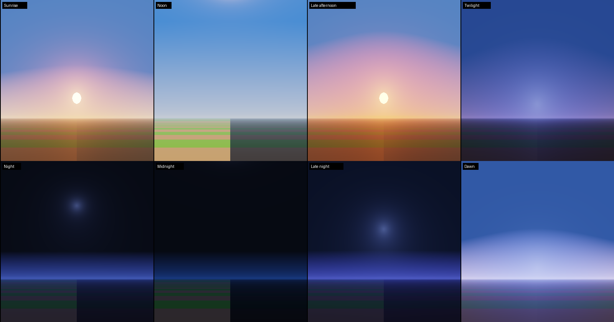
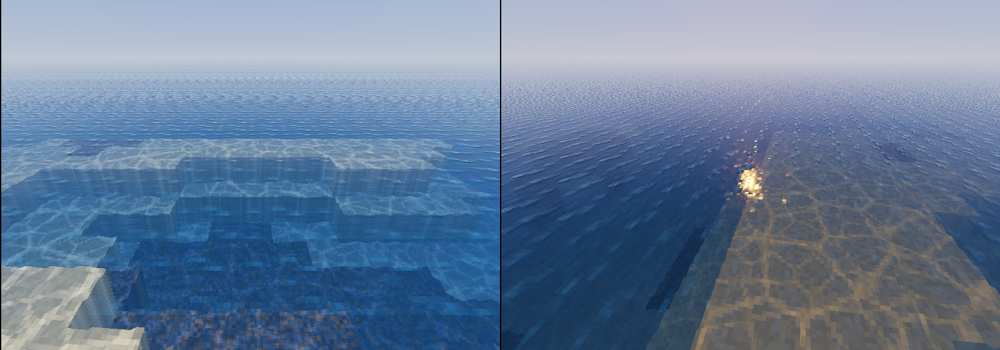

# Vibrant Visuals for Java (Iris shader pack)

A shader pack for **Minecraft Java 26.3 (Fabric + Iris)** that recreates the look of
Bedrock's **Vibrant Visuals** graphics mode. It uses Mojang's own default Vibrant Visuals
settings (from `Mojang/bedrock-samples`) for the sky colours, sun colours, light
intensity, tone mapping, fog, water and PBR values. See [RESEARCH.md](RESEARCH.md) for
everything learned about the original and where each number comes from.





*These previews are rendered from this pack's real GLSL code (headless WebGL,
with a simple test seabed). They are not in-game screenshots.*

## Install (Minecraft 26.3)

1. Install **Fabric Loader** for 26.3, plus **Fabric API**.
2. Put **Sodium 0.9.2** (or newer for 26.3) and **Iris 1.11.7** (or newer for 26.3) in `mods/`.
3. Copy `release/VibrantVisualsJava.zip` into `.minecraft/shaderpacks/`.
   You can also copy the `vibrant-visuals-iris` folder there, as long as it contains `shaders/`.
4. In game, open **Options → Video Settings → Shader Packs** and pick *VibrantVisualsJava*.

## What Vibrant Visuals changes, and how this pack does it

| Vibrant Visuals (Bedrock) | Vanilla Java | This pack |
|---|---|---|
| Sun shadows, **blocky**: snapped to the 16×16 texel grid | Only smooth-lighting AO | Shadow map where each texture pixel is looked up at its texel centre, so pixels are fully lit or fully shaded (soft shadows are optional) |
| Sun colour keyframed over the day: white at noon, orange `(255,127,0)` at sunset | Flat, uncoloured light | Exact `lighting/global.json` sun colour and illuminance keyframes |
| Atmospheric sky: zenith and horizon colours, Rayleigh, sun Mie glow, glare, horizon blend stops | Two flat colours | Port of `atmospherics.json`: all keyframes plus the 3-band shape (horizon, blend start, Mie bump around the sun) |
| Volumetric fog and haze, with distant hills fading out | Linear fog | Ray-marched god rays through the shadow map, a sky-coloured distance haze (orange toward the sun at sunset), stronger fog at sunrise, and border fog at the edge of render distance |
| Water: **still the vanilla water texture**, tinted by the biome colour, with a normal map from that texture, very glossy, no waves, pixel caustics | Flat, semi-opaque texture | Keeps the vanilla water texture and uses Bedrock's brighter biome colour (Java's default `#3F76E4` becomes `#44AFF5`). Builds a normal from the texture's own ripple pattern, so reflections and sun glints break into blocky pixels. Shallows stay clear, deeper water turns the biome colour. Adds Fresnel and screen-space reflections, a calm mirror far away, and pixel caustics stepped every 0.09 s like `water.json` |
| Translucent clouds lit by the sun | White clouds | Clouds lit by sun, sky and horizon colour, with a warm forward-scatter rim at sunset |
| The vanilla sun's 8×8 core only (`sun_vv.png`), glowing through the sky glare | Sun with a dim halo | Draws only the bright core of the vanilla sun texture, with glare from the sky model and bloom |
| Glowing blocks; mob eyes (spider, Enderman, Phantom) glow softly; player eyes don't | Eyes always fullbright, no bloom | Emissive glowstone, lanterns, torches and lava, softly glowing mob eyes, and mip-chain bloom |
| `color_grading.json`: contrast 1.15, saturation 1.05, "generic" tone mapper | None | Same contrast and saturation, the Lottes "generic" filmic curve, and eye adaptation for caves and nights |
| Leaves and grass glow when backlit (subsurface); sheep wool and zombie / villager skin too; **no waving** | Flat | Subsurface on leaves, plants, sheep, zombies and villagers. Waving plants exist but are **off by default** |

Nether and End get their own simpler lighting and fog, with no shadow pass.

## Settings

Open **Shader Pack Settings** to choose a profile (Low / Medium / High / Ultra) or to tune
individual options:

- **Lighting:** sun, sky light, torch light, night brightness, glowing blocks, leaf glow, waving plants
- **Shadows:** blocky (on by default) or soft, resolution, distance, filter samples, softness, sun path angle
- **Sky:** sun glow, sun brightness, stars, cloud opacity
- **Atmosphere:** god rays (on/off, quality, strength), haze density, sunrise fog
- **Water:** reflections, caustics, ripple strength, clarity, extra ocean waves (off by default)
- **Camera:** bloom, eye adaptation, exposure, contrast, saturation, vibrance

For Vibrant Visuals' straight overhead sun path, set *Sun Path Angle* to 0.
The default (-20°) gives nicer noon shadows.

## Layout

```
shaders/
  shaders.properties   menu, profiles, Iris flags
  block.properties     block -> material ids (plants, leaves, water, emissive, glass, lava)
  entity.properties    entities with subsurface (sheep, zombies, villagers)
  lang/en_us.lang      option names
  lib/                 shared code
    atmosphere.glsl    Vibrant Visuals keyframes + sky model
    lighting.glsl      sun / sky / torch / subsurface lighting
    shadows.glsl       shadow distortion + PCF
    water.glsl         vanilla-texture water normals, caustics, water shading
    tonemap.glsl       colour grading + generic tone mapper
  program/             the real shader sources
  *.vsh / *.fsh        tiny stubs (overworld); world-1/ = Nether, world1/ = End
tools/generate-stubs.sh  regenerates the stubs
```

After adding a program to `tools/generate-stubs.sh`, run it again.

## Known limits

- Vibrant Visuals uses a per-texture MERS map, so roughness and leaf subsurface vary pixel
  by pixel. This pack uses one value per material type instead, because Mojang's textures
  can't be shipped.
- Reflections are screen space. Anything off screen is replaced by the sky.
- The pack was compile-checked with `glslangValidator`, and the sky was previewed in WebGL.
  It has not been run in-game yet, so some values may need tuning with the in-game sliders.
